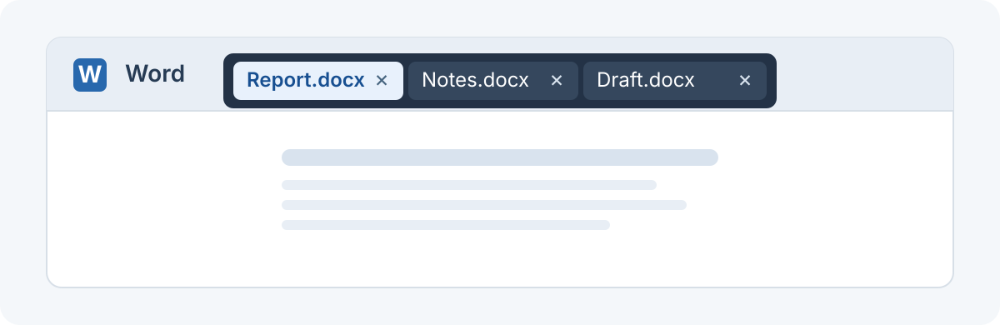

<p align="center"></p>

# MacOfficeTabs

**A floating tab bar for Word, Excel, and PowerPoint on macOS.** Switch between documents and reorder tabs while Office keeps its own windows and save dialogs.

[English](README.md) · [简体中文](README.zh-CN.md) · [Quick start](#quick-start) · [Known limitations](#known-limitations)

> [!IMPORTANT]
> Full product acceptance is incomplete. The steps below create a locally signed app from source, not a public distribution installer. The app interface is currently in Simplified Chinese.

<p align="center"></p>

*Illustration of the tab bar, not an application screenshot. The bar appears inside the foreground Office document window; it does not merge documents into one window.*

## Quick start

You need macOS 13 or later, a compatible Xcode or Command Line Tools installation, and at least one of Word, Excel, or PowerPoint. From the repository root:

```sh
bash scripts/build-app.sh
open build/MacOfficeTabs.app
```

In the **“Office 窗口诊断”** window, click **“打开辅助功能设置”** and grant MacOfficeTabs Accessibility control permission. Open documents in Office, bring an editing window to the front, and click a tab to switch. See [First launch](#first-launch) for permission details and [Build details](#build-details) for signing options.

## What it does

- **Tabs for the foreground Office app.** Word, Excel, and PowerPoint keep separate document lists and settings. The bar hides when another app is in front.
- **Consistent placement.** A narrow bar centered inside the top of the document window in normal, maximized, and native fullscreen modes. It may cover a small part of the Office toolbar.
- **Click to switch, drag to reorder.** Scroll horizontally for more tabs. Short runtime IDs help distinguish documents with the same title.
- **Native document closure.** The tab's × requests Office's close command. Office handles saving, discarding changes, and cancellation.
- **Optional keyboard navigation.** Cycle through the current app's tabs with `Control + Option + Command + ← / →`, following their visual order.
- **Per-app settings and optional launch at login.** Shortcuts and launch at login are off by default; all three apps' tab bars are enabled by default.
- **Window diagnostics.** Inspect permissions, document candidates, focus verification, and panel visibility.

## Requirements and compatibility

| Item | Requirement / recorded environment |
| --- | --- |
| Deployment target | macOS 13.0 or later |
| Build tools | Swift tools 5.9 or later; Xcode or Command Line Tools with a compatible macOS SDK |
| Office | Microsoft Word, Excel, or PowerPoint installed separately |
| Permission | Accessibility control permission for MacOfficeTabs |
| Third-party package dependencies | None |
| Recorded test environment | Apple Silicon (arm64), macOS 27.0.1 (26A434), Office 16.113.4 |

The minimum deployment target is not a compatibility guarantee. Intel, other macOS and Office versions, multiple physical displays, and Stage Manager have not been verified. The public compatibility summary and remaining gaps are listed under [Known limitations](#known-limitations).

## Build details

The build script compiles the release executable, assembles `build/MacOfficeTabs.app`, signs it, and verifies the signature. Without local signing configuration, it uses ad-hoc signing. It builds for the current toolchain's architecture, rather than producing a universal app.

For a persistent local development signing identity, run this **before building and granting permission**:

```sh
bash scripts/setup-dev-signing.sh
bash scripts/build-app.sh
open build/MacOfficeTabs.app
```

The setup script creates a project-specific certificate and keychain in `.dev-signing/`. It does not change system root trust or the login/default keychain. This directory contains private keys and credentials and is ignored by Git; never upload or share it. Local development signing is not Developer ID distribution signing or notarization.

## First launch

1. Build and open the app. The initial window is **“Office 窗口诊断”** (Office window diagnostics).
2. Click **“打开辅助功能设置”** (Open Accessibility Settings). Enable MacOfficeTabs in the system's app control permissions. Older macOS versions usually place this under **Privacy & Security → Accessibility**; the tested macOS 27 labels it **“设备控制和数据访问”**.
3. If needed, use **+** to add the `build/MacOfficeTabs.app` you just built, enable it, then return to the app and click **“刷新”** (Refresh).
4. Open documents in Office and bring a document editing window to the foreground. Click a tab title to switch documents.

Grant permission after building. A changed signing identity or ad-hoc rebuild may require removing the old permission entry and adding the current app again. Check the app's actual diagnostic status rather than relying only on the system toggle.

## Everyday use

| Action | How |
| --- | --- |
| Switch documents | Click a tab title |
| Reorder tabs | Drag the title left or right; order is kept only for the current runtime |
| Find more tabs | Scroll horizontally inside the bar |
| Close a document | Click an enabled ×, then respond to Office's own save prompt |
| Open settings | **MacOfficeTabs → 设置…**, or `Command + ,` while the tool is foreground |
| Navigate with shortcuts | Enable **“启用 ⌃⌥⌘←/→ 切换当前应用标签”**, then click tabs to establish verified focus |
| Inspect a problem | Open **“显示窗口诊断”** from the app menu |
| Quit the tool | **MacOfficeTabs → 退出 MacOfficeTabs**, or `Command + Q` while the tool is foreground |

The × stays disabled until a tab is reliably associated with a real window. With multiple documents, switching to another tab and back can establish that association. When identity or focus is uncertain, use Office's own close command.

The bar and shortcuts pause during save dialogs, permission failures, or unsafe/unknown window states. The app never chooses a save or discard action for you. Quitting MacOfficeTabs leaves Office running. Closing the last tool window also exits the app; minimize the diagnostics window to keep it running.

Shortcuts require at least two tabs, verified focus, and the corresponding Office app in front. If registration fails, both shortcuts are released; after resolving the conflict, turn the setting off and on to retry. Some non-exclusive shared shortcut registrations cannot be reliably detected.

## Privacy and permissions

Normal operation uses macOS Accessibility APIs to read window/menu metadata, verify focus, and request native switching or closure. It does not read document body content, edit documents, or automatically save them. The current source has no telemetry or network upload implementation.

Copied diagnostics and command-line reports can contain document titles and other window metadata. Review and redact them before sharing. A separate, explicitly invoked Word automation research probe exists in the source; it is not part of normal operation and is not required for tab management.

## Known limitations

- Only the foreground Office app's tabs are shown; there are no mixed groups spanning Word, Excel, and PowerPoint.
- Tab order is not persisted across tool restarts; short IDs are runtime identifiers, not permanent file IDs.
- PowerPoint slideshow windows are outside the editing scope. Excel's own restrictions on opening same-named workbooks still apply.
- Launch-at-login registration and removal have been tested locally; automatic launch after an actual logout/login has not.
- Multiple displays, other architectures/versions, and end-to-end window-following latency remain unverified. Full product acceptance is incomplete.
- There is no automatic updater or notarized distribution package in the current project.

## Development and contributing

```text
Sources/OfficeTabsCore/    Identity, routing, ordering, preferences, and safety rules
Sources/MacOfficeTabs/     Accessibility integration, native UI, shortcuts, and diagnostics
Tests/OfficeTabsCoreTests/ Core logic tests
Resources/Info.plist       App metadata and version
scripts/                  Build, local signing, and targeted verification tools
docs/user-guide.md        Detailed Chinese user guide
```

Run `swift test` for core logic tests and `bash scripts/build-app.sh` to check the app build. Core tests do not replace real Office interaction testing. Follow [CONTRIBUTING.md](CONTRIBUTING.md) for manual checks of affected user flows. Some verification scripts actually switch documents or reserve shortcuts; use disposable documents for those experiments.

Bug reports should include the app version/build, macOS version, architecture, Office version, window mode, reproduction steps, and expected/actual behavior. Attach redacted diagnostics where useful. For contributions, explain the behavior change and relevant verification, preserving identity checks and native save dialogs.

## Documentation

- [Detailed user guide (Chinese)](docs/user-guide.md)
- [Contributing and testing](CONTRIBUTING.md)
- [Security reporting](SECURITY.md)

Local research notes, diagnostic logs, screenshots, and test documents are excluded from the public source tree because they can contain private document titles and machine paths.

## License

This project is source-available under the [Apache License 2.0, subject to Commons Clause 1.0](LICENSE). Both apply together.

Personal use, internal business use, modification, and free redistribution are permitted subject to the full license terms. Commons Clause restricts providing a product or service for a fee or other consideration when its value derives entirely or substantially from this software, including a renamed or cosmetically modified paid version. It does not prohibit every commercial integration or paid bundle; the full license controls. Redistribution must retain the required notices, including Commons Clause, and identify modified files as required by Apache 2.0.

Sponsorship is voluntary and does not change your rights under the license. Contributions are accepted under the same combined license unless separately agreed in writing.

MacOfficeTabs is an independent project and is not affiliated with or endorsed by Microsoft. Microsoft Office, Word, Excel, and PowerPoint are trademarks of Microsoft.
